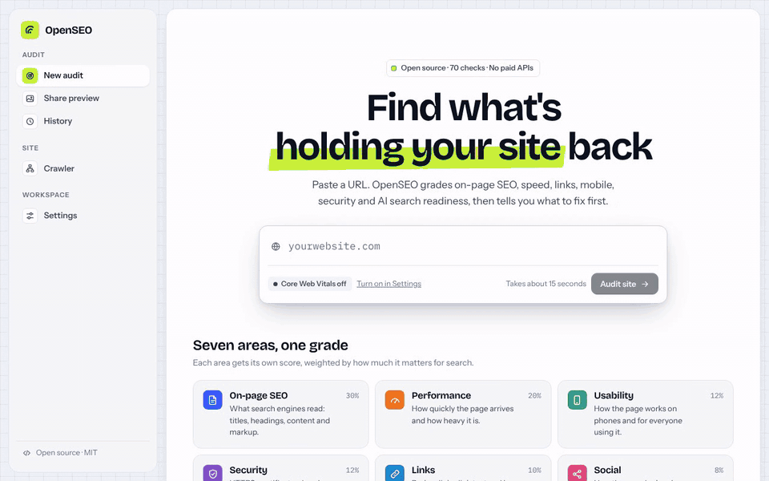

# OpenSEO

An open-source SEO audit tool you run yourself. Paste a URL and, about 15 seconds later, get a
graded report (A+ to F) across on-page SEO, performance, usability, security, links, social and
AI search readiness, with the fixes ranked by how much they matter.

No paid APIs, no account, no database to set up.

[](https://github.com/alexsilver8/openseo/actions/workflows/ci.yml)
[](https://github.com/alexsilver8/openseo/releases)
[](LICENSE)

```bash
docker run -d --name openseo -p 3000:3000 -v openseo-data:/data ghcr.io/alexsilver8/openseo
```

Then open [http://localhost:3000](http://localhost:3000). [More ways to run it](#run-it).



OpenSEO is an independent project inspired by hosted audit tools like SEOptimer. It is not
affiliated with any of them.

## What it does

- **Audits a page with ~70 checks** in seven categories, each with its own grade, weighted into
  one overall score.
- **Tells you what to fix first**: problems are ranked by priority, and every one says how to
  fix it, with the evidence (the tags it found, the slow files, the broken links).
- **Crawls a whole site**: follows links page by page and finds broken pages, missing or
  duplicate titles and descriptions, missing H1s, thin content, slow pages and noindex.
- **Keeps a history** of every audit with shareable links and each site's score over time.
- **Exports** reports as PDF (print-ready) and JSON, and crawls as CSV.
- **White-label reports**: your name, logo, accent color, footer and a call to action button,
  set in `data/settings.json`.
- **Has an API and a CLI** for scripts and CI.
- **Checks AI search readiness**: whether ChatGPT, Claude and Perplexity can crawl and quote the
  page, llms.txt, server-rendered content and entity markup.
- **Shows how your links look when shared** on Google, Facebook, X, LinkedIn, Slack, Discord,
  WhatsApp and iMessage, following each platform's rules for image size and card type. It also
  measures the share image and every favicon, Apple touch icon and web app manifest icon. It's
  part of every report and works on its own as Share preview.


## What it checks

| Category    | Weight | Checks                                                                                                                                                                                                                                                            |
| ----------- | -----: | ----------------------------------------------------------------------------------------------------------------------------------------------------------------------------------------------------------------------------------------------------------------- |
| On-page SEO |    30% | Title, meta description, search result preview, H1, heading structure, amount of content, keyword consistency, image alt text, canonical, indexability, robots.txt, XML sitemap, structured data, language, hreflang, analytics, readable URL, doctype, local SEO |
| Performance |    20% | Core Web Vitals (with PageSpeed Insights), server response time, download time, page size, requests, compression, HTTP/2 and HTTP/3, image optimization, caching, minification, render-blocking files, redirects, image dimensions, lazy loading, DOM size        |
| Usability   |    12% | Mobile viewport, phone and desktop screenshots, accessibility score, form labels, favicon, Apple touch icon, web app manifest, theme color, font sizes, iframes, legacy plugins, exposed emails, deprecated HTML, inline styles                                   |
| Security    |    12% | HTTPS, HTTP to HTTPS redirect, SSL certificate expiry, mixed content, HSTS, security headers, SPF and DMARC, cookie flags, server version exposure, server and IP                                                                                                 |
| Links       |    10% | Broken links (checked live), internal and external links, link text, nofollow on internal links                                                                                                                                                                   |
| Social      |     8% | Open Graph tags, share image (loads, size, shape and weight), X card, social profiles, ad pixels                                                                                                                                                                  |
| AI search   |     8% | AI crawler access in robots.txt (search and training crawlers separately), content without JavaScript, publisher markup, snippet controls, semantic HTML, llms.txt, dates                                                                                         |

Checks that pass earn their full weight, warnings half, failures nothing. Informational checks
(like the search result preview) are shown but not scored.

## Run it

All you need is [Docker Desktop](https://www.docker.com/products/docker-desktop/) (or Docker
Engine on Linux). Start OpenSEO with:

```bash
docker run -d --name openseo --restart unless-stopped -p 3000:3000 -v openseo-data:/data ghcr.io/alexsilver8/openseo
```

Open [http://localhost:3000](http://localhost:3000) and paste a URL. OpenSEO keeps running in the
background and starts again with Docker. Reports, crawls and settings live in the `openseo-data`
volume, so they survive restarts and updates. The image works on Intel and Apple silicon.

| To                    | Run                                                                                  |
| --------------------- | ------------------------------------------------------------------------------------ |
| Stop it               | `docker stop openseo`                                                                |
| Start it again        | `docker start openseo`                                                               |
| See what it's doing   | `docker logs -f openseo`                                                             |
| Update to the latest  | `docker pull ghcr.io/alexsilver8/openseo`, then `docker rm -f openseo` and run again |
| Use another port      | Change `-p 3000:3000` to `-p 8080:3000`                                              |
| Delete all saved data | `docker rm -f openseo && docker volume rm openseo-data`                              |

To turn on Core Web Vitals, add a free PageSpeed API key under **Settings** in the app. Other
options from the table below go in with `-e`, like `-e ADMIN_PASSWORD=…`.

To audit a site running on your own computer, add
`-e OPENSEO_ALLOW_PRIVATE=true --add-host host.docker.internal:host-gateway` to the command and
use `http://host.docker.internal:<port>` instead of `localhost` (inside Docker, `localhost` is
OpenSEO itself).

### Build it from source

```bash
git clone https://github.com/alexsilver8/openseo.git
cd openseo
docker compose up -d
```

The first build takes a few minutes. With Compose, put options in a `.env` file next to
`docker-compose.yml`; `docker compose up -d --build` picks up new code after a `git pull`.

### Without Docker

Requires Node.js 22.12 or newer and [pnpm](https://pnpm.io/installation) 12
(`npm install -g pnpm` if you don't have it).

```bash
pnpm install
pnpm dev             # http://localhost:3000
```

Or for a faster production build: `pnpm build && pnpm start`.

### Settings

Everything below is optional. With `docker run`, pass them with `-e`; with Compose, put them in a
`.env` file next to `docker-compose.yml`; without Docker, copy `.env.example` to `.env.local`.

| Variable                 | Does                                                                                               |
| ------------------------ | -------------------------------------------------------------------------------------------------- |
| `PAGESPEED_API_KEY`      | A free Google PageSpeed key for Core Web Vitals and screenshots. You can also add it in Settings   |
| `ADMIN_PASSWORD`         | Asks for a password (user `admin`) on history, the crawler and settings                            |
| `OPENSEO_DATA_DIR`       | Where data is stored. Defaults to `./data`                                                         |
| `OPENSEO_RATE_LIMIT`     | Audits per visitor per hour, and the same number of share previews. Defaults to 60; 0 turns it off |
| `OPENSEO_MAX_CONCURRENT` | Audits and crawls running at once. Defaults to 4                                                   |
| `OPENSEO_ALLOW_PRIVATE`  | Set to `true` to audit localhost and private networks                                              |
| `OPENSEO_USER_AGENT`     | The User-Agent sent to audited sites                                                               |

You only need `ADMIN_PASSWORD` if other people can reach your OpenSEO, like on a shared network.
Shared reports, the home page and Share preview stay open; everything else asks for it.

The theme (light by default, or dark, or matching the system), PageSpeed, how many links to check
and how many pages to crawl are in the app under **Settings**.

Branding has no form in the app. To white-label reports, set `brandName`, `brandLogo` (a URL or
data URI), `brandColor` (a hex color), `reportFooter`, `ctaText` and `ctaUrl` in
`data/settings.json`, or send them to `PUT /api/settings`. Changes apply on the next page load.

## API

```bash
# Audit and wait for the full report
curl -X POST https://your-openseo/api/audit \
  -H 'content-type: application/json' \
  -d '{"url": "example.com", "stream": false}'

# Or stream progress as newline-delimited JSON, ending with {"type":"done","id":"…"}
curl -N -X POST https://your-openseo/api/audit -d '{"url": "example.com"}'
```

| Endpoint                    | Does                                                      |
| --------------------------- | --------------------------------------------------------- |
| `POST /api/audit`           | Runs an audit: `{ url, stream? }`                         |
| `GET /api/reports/:id`      | One report as JSON (public, like the report page)         |
| `GET /api/preview?url=`     | Share previews, images, icons and tags for one page       |
| `GET /api/reports`          | History, newest first. `?domain=example.com` filters it   |
| `POST /api/crawl`           | Crawls a site: `{ url, maxPages? }`, streamed like audits |
| `GET /api/crawls/:id`       | One crawl as JSON, or `?format=csv`                       |
| `GET` / `PUT /api/settings` | Read or change settings                                   |

With `ADMIN_PASSWORD` set, everything except `POST /api/audit`, `GET /api/preview` and
`GET /api/reports/:id` needs basic auth. The audit and Share preview pages stay public too.

## Terminal

```bash
pnpm scan example.com              # grades and what to fix
pnpm scan example.com --all        # every check
pnpm scan example.com --json       # the full report
pnpm crawl example.com --pages 200 # crawl up to 200 pages
```

## Your data

Everything is plain JSON in the data folder:

| File                | Holds                |
| ------------------- | -------------------- |
| `reports/<id>.json` | One audit report     |
| `reports.json`      | The history index    |
| `crawls/<id>.json`  | One crawl            |
| `crawls.json`       | The crawl index      |
| `settings.json`     | Branding and options |

Back it up by copying the folder.

## Good to know

- Audits run on your server without a browser, so they see the HTML your server sends.
  Timings are measured from your server; turn on PageSpeed Insights for real-browser numbers.
- Some sites block automated requests. OpenSEO says so instead of guessing.
- OpenSEO refuses to audit private and internal addresses unless you allow it, so a public
  install can't be used to reach your own network.
- Backlinks, keyword rankings and keyword research need large paid data sets, so they aren't
  included. The audit engine is a plain module in `src/server/audit`, ready for a data provider.


## Develop

```bash
pnpm dev             # the app with hot reload
pnpm typecheck
pnpm test
pnpm format
pnpm cleaner         # checks the component conventions
```

The code is laid out like this:

| Folder       | Holds                                                     |
| ------------ | --------------------------------------------------------- |
| `src/app`    | Next.js routes and API endpoints, kept thin               |
| `src/web`    | The React UI: shared components, screens, styles          |
| `src/server` | The audit engine, crawler, storage and limits             |
| `src/shared` | Types, grades, settings and formatting used on both sides |
| `scripts`    | The CLI and repository tooling                            |

See [CONTRIBUTING.md](CONTRIBUTING.md) for the code style and how pull requests work.

## License

MIT
